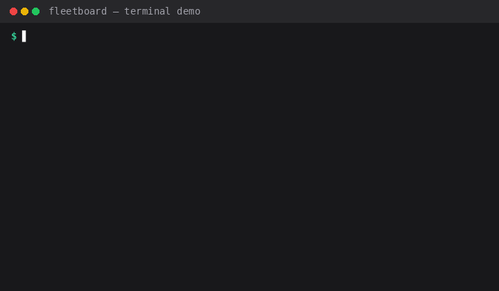
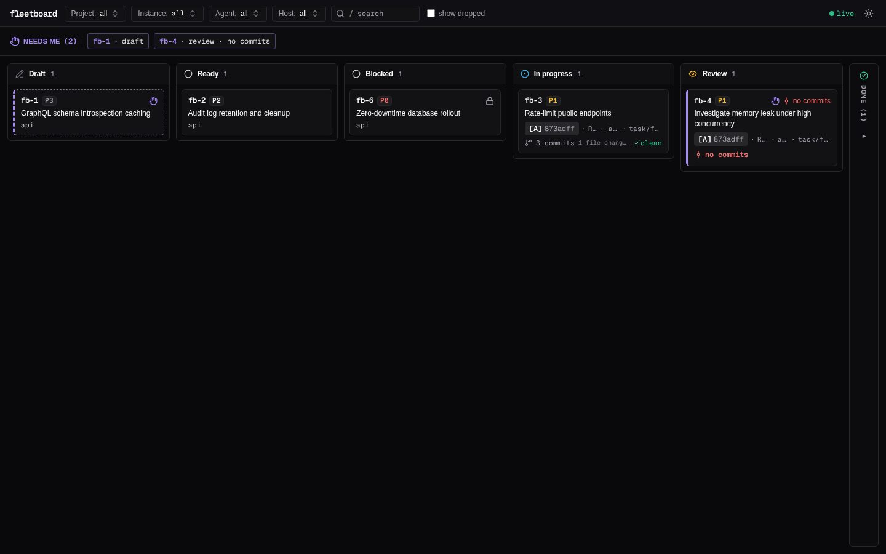
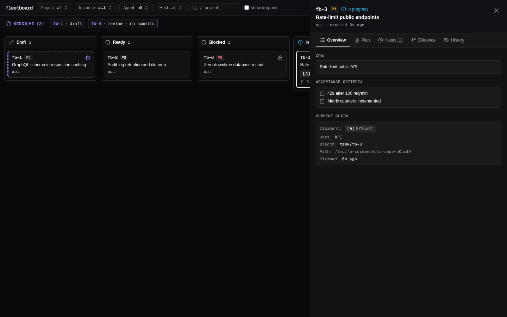
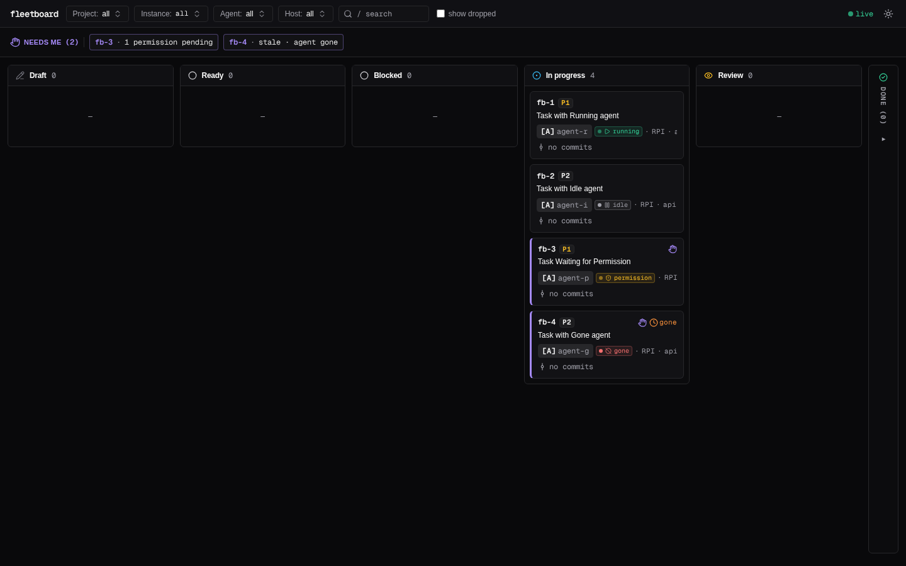

# fleetboard

A task board for one person running a fleet of coding agents (Claude Code, Codex, Antigravity, …) across many repos.



---

## Why fleetboard?

Running five or more coding agents at the same time quickly breaks standard tools:

1. **Tasks are spread across repos.** Repo-local trackers (Beads, Backlog.md) store one database per project. Fleetboard provides **one central board** across every repo and checkout.
2. **The same repo runs as multiple instances.** One repo can be open in five agent workspaces at once with different checkouts, branches, and agents. Fleetboard binds tasks to `(host, cwd, branch, agent)`, not just a repo name.
3. **Agents mark their own work "done".** In practice, human operators manually verify `git log` and diffs. In fleetboard, `fb done` on code tasks lands in **Review** gated by live git evidence (commits since claim, clean worktree). The human verifies before a task reaches Done.
4. **The human is the bottleneck.** What needs operator attention (drafts, plans awaiting approval, stale claims, reviews, runtime pending permissions) is surfaced in a dedicated **Needs me** queue.
5. **Orchestrator optional.** Sits next to whatever orchestrator you use (Paseo, agent CLI hooks, or standalone agents with shell/MCP access).

---

## Web UI

Fleetboard includes an embedded React + shadcn/ui dashboard served directly from the single binary:



### Task Inspection & Git Evidence

View live git evidence, diffstat, worktree status, agent handoff notes, and complete audit history:



### Orchestrator Runtime States

When used with an orchestrator adapter (such as Paseo or CLI hooks), cards display live status dots (`running`, `idle`, `permission`, `gone`):



---

## Installation

### From Source

Ensure the Rust toolchain (1.80+) is installed:

```bash
git clone https://github.com/narinthon-so/fleetboard.git
cd fleetboard
cargo install --path .
```

Verify the installation:

```bash
fb --version
```

---

## 5-Minute Quickstart (Without Paseo)

This walk-through demonstrates the complete operator-agent lifecycle on a standard machine without an external orchestrator.

### 1. Start the Board (Optional)

In one terminal, start the embedded web dashboard:

```bash
fb serve --as-human
```

The daemon prints a loopback URL and one-time authentication token. Open it in your browser to watch cards update in real time via Server-Sent Events (SSE). Serving requires a shell with no agent markers (`--as-human`; it is refused when running under an agent).

### 2. Operator Adds a Task

From your project directory, create a task as the human operator:

```bash
fb add "Implement JWT authentication" \
  --goal "Verify bearer tokens on protected /api routes" \
  --ac "Return 401 for missing or expired tokens" \
  --as-human
```

The task enters `todo` with ID `fb-1`. (Tasks created by agents land as `draft` in Needs-me for human promotion).

### 3. Agent Inspects Context and Claims

In the agent's workspace or shell:

```bash
# 1. Inspect identity and workflow context
fb prime

# 2. List ready, unblocked tasks
fb ready

# 3. Claim the task
fb claim fb-1
```

Fleetboard atomically binds `fb-1` to the agent's instance `(host, cwd, branch, actor)`.

### 4. Agent Codes, Notes, and Finishes

```bash
# Agent creates feature branch and commits work
git checkout -b task/fb-1
# ... write code and tests ...
git add .
git commit -m "feat: add JWT auth middleware and unit tests"

# Leave a handoff note for the operator
fb note fb-1 "Implemented JWT verification; test suite passing on task/fb-1."

# Finish the task
fb done fb-1
```

For `code` tasks, `fb done` records live git evidence and moves the task to **Review**.

### 5. Operator Verifies Evidence and Closes

Back in the human terminal:

```bash
# Check tasks needing attention
fb list --needs-me --as-human

# Inspect recorded git evidence (commits, diffstat, clean tree)
fb show fb-1 --evidence --as-human

# Verify review and mark done
fb verify fb-1 --as-human
```

---

## Agent Workflow

Agents interact with `fb` via standard CLI commands or `--json` mode:

| Step | Command | Description |
|---|---|---|
| **Context** | `fb prime` | Prints caller identity, active claim, latest handoff note, and recommended next steps. |
| **Discover** | `fb ready` | Lists unblocked tasks ready to be claimed. |
| **Claim** | `fb claim [<id>]` | Atomically claims a task (or highest priority unblocked task if `<id>` is omitted). |
| **Plan** | `fb plan <id> <text\|->` | Submits an implementation plan (required when `--plan-approval` is enabled). |
| **Note** | `fb note <id> <text\|->` | Appends a `handoff`, `comment`, or `finding` note to the task. |
| **Done** | `fb done <id> [--result …]` | Moves code tasks to `review` with live git evidence. For `note` tasks, `--result` is required. |

### Machine Output (`--json`)

Every CLI command supports `--json` returning a standard JSON envelope:

```json
{
  "v": 1,
  "ok": true,
  "data": { "id": 1, "title": "Implement JWT authentication", "status": "review" }
}
```

On errors, the envelope includes structured codes (`CLAIM_HELD`, `NOT_READY`, `BAD_TRANSITION`, `HUMAN_ONLY`):

```json
{
  "v": 1,
  "ok": false,
  "error": { "code": "CLAIM_HELD", "message": "fb-1 is claimed by claude 60a1168" }
}
```

---

## Hooks and Model Context Protocol (MCP)

Fleetboard supports deep agent integration through hooks and MCP:

- **CLI Lifecycle Hooks ([docs/hooks.md](docs/hooks.md)):** Configure Claude Code or Codex hooks to call `fb hook <event>`. Automatically records agent activity, bumps claim freshness, and injects `fb prime` context at session start.
- **MCP Server ([docs/mcp.md](docs/mcp.md)):** Run `fb mcp` over stdio to give Claude Code, Codex, or Antigravity native MCP tool access for adding, claiming, noting, and finishing tasks without shell invocations.

---

## Delegation

The human operator can delegate specific privileges to an agent actor (e.g. an autonomous QA or lead agent) using `fb delegate`:

```bash
# Delegate promotion, verification, and rejection to an agent
fb delegate "claude 60a1168" --allow promote,verify,reject --as-human
```

- Delegated agents can run those specified actions directly without `--as-human`.
- All actions taken under delegation are recorded in the audit log with `on_behalf_of = 'human'`.
- The CLI and Web UI display delegated actions clearly (e.g., `claude 60a1168 on behalf of human`).
- Revoke delegation at any time:
  ```bash
  fb undelegate "claude 60a1168" --as-human
  ```

---

## Known Limitations

- **Cooperative guard, not security sandbox:** Fleetboard's human vs. agent distinction (`--as-human`) prevents eager agents from accidentally promoting their own drafts or verifying their own code. An agent with arbitrary shell access could theoretically bypass CLI guards or modify SQLite files directly.
- **Process isolation:** Process ancestry inspection detects known agent binaries (`claude`, `codex`, `agy`). An agent process explicitly detaching via `setsid` or external daemons could mask its ancestry.
- **Web UI loopback protection:** The web server binds strictly to `127.0.0.1` and requires a secret session token printed in the human's terminal on startup plus an `X-Requested-With` header on mutating requests.
- **Single-host default:** The default store is a local SQLite database (`$FB_HOME/board.db`, WAL mode). Multi-host synchronization is planned for future milestones.

---

## License

[MIT](LICENSE) © 2026 narinthon-so
