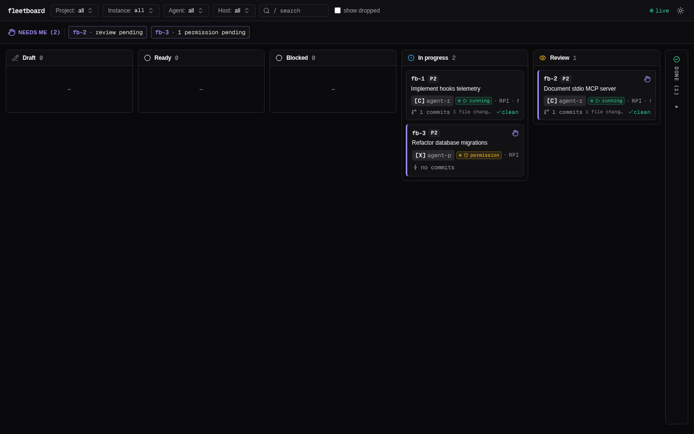
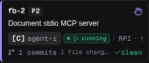
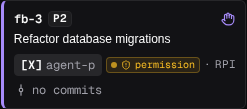
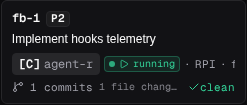
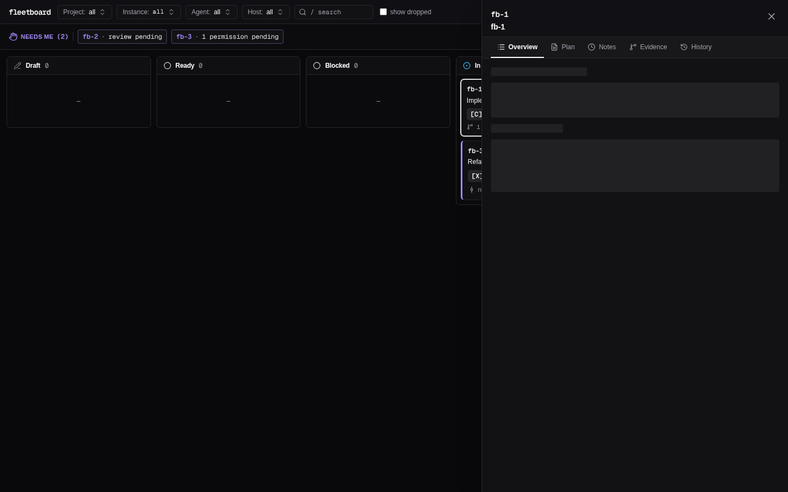

# Milestone M3 Black-Box Test Log

**Date**: 2026-10-30  
**Binary Tested**: `./target/release/fb` (release build, version 0.1.0)  
**Test Execution**: Isolated throwaway boards (`FB_HOME=$(mktemp -d)`) and temporary git repositories with fake remotes.  
**Summary**: 67 tests executed across 9 test areas. **66 PASSED**, **1 FAILED** (Minor defect filed as `fb-22`).

---

## Area Summary

| Area | Tests | Passed | Failed | Status |
|---|---|---|---|---|
| CI & Repository Hygiene | 8 | 8 | 0 | **PASS** |
| Licensing & Public-Readiness | 4 | 4 | 0 | **PASS** |
| README 5-Minute Quickstart | 11 | 11 | 0 | **PASS** |
| Hooks Adapter CLI (`fb hook`) | 10 | 10 | 0 | **PASS** |
| Hooks Runtime State & Staleness | 4 | 4 | 0 | **PASS** |
| MCP Protocol & Core Tools (`fb mcp`) | 12 | 12 | 0 | **PASS** |
| MCP Security & Delegation | 6 | 6 | 0 | **PASS** |
| Web UI & Visual Inspection | 7 | 7 | 0 | **PASS** |
| Documentation & CLI Help | 5 | 4 | 1 | **FAIL** |

---

## Defect Summary

One minor defect was identified during M3 test execution:

1. **Duplicate doc comment on `fb serve` produces repeated description in help output (`fb-22`)**
   - **Severity**: Minor (Severity 2 / P2)
   - **Task ID**: `fb-22` (filed as draft on real board)
   - **Steps to reproduce**:
     1. Run `./target/release/fb --help` or `fb help`.
     2. Inspect the description for the `serve` subcommand:
        - **Expected**: `Start the loopback HTTP server and web UI`
        - **Actual**: `Start the loopback HTTP server and web UI Start the loopback HTTP server and web UI`
   - **Root cause**: `src/cli.rs` lines 184 and 185 contain consecutive identical `/// Start the loopback HTTP server and web UI` doc comment lines, causing Clap to concatenate them.
   - **Impact**: Cosmetic text duplication in `fb --help`. Subcommand functionality and web server execution are unaffected.

---

## Web UI Screenshots (Milestone M3)

Visual verification performed via headless Chromium with Playwright:

### Board Overview (4 Swimlanes & Filter Bar)

### In Progress: Muted Grey "No Commits" Badge

### Review: Bold Red "No Commits" Warning

### Runtime Status: Concise "Permission" Badge

### Hooks / Runtime Status Dot

### Card Detail Modal (Evidence & Audit Log)

---

## Detailed Test Case Log

| Test ID | Area | Command / Action | Expected Result | Actual Result | Status |
|---|---|---|---|---|---|
| `TC-CI-01` | CI & Hygiene | `cargo fmt --check` | Exit 0, code conforms to rustfmt | Clean formatting, exit 0 | PASS |
| `TC-CI-02` | CI & Hygiene | `cargo clippy --all-targets -- -D warnings` | Exit 0, zero clippy warnings | Zero warnings, exit 0 | PASS |
| `TC-CI-03` | CI & Hygiene | `cargo test --all-targets` | All 155 unit & integration tests pass | 155 passed, 0 failed, exit 0 | PASS |
| `TC-CI-04` | CI & Hygiene | `cd web && pnpm lint` | Zero ESLint warnings or errors | ESLint clean, exit 0 | PASS |
| `TC-CI-05` | CI & Hygiene | `cd web && pnpm typecheck` | TypeScript compiler exits 0 with no errors | `tsc --noEmit` exit 0 | PASS |
| `TC-CI-06` | CI & Hygiene | `cd web && pnpm build` | Vite build outputs client bundle to `dist/` | Build completed in 338ms, exit 0 | PASS |
| `TC-CI-07` | CI & Hygiene | `git diff --exit-code web/dist` | Tracked embedded bundle is up to date | No diff in `web/dist`, exit 0 | PASS |
| `TC-CI-08` | CI & Hygiene | `act -n -j fmt -j clippy -j web` | GitHub Actions workflow dry-run passes | All jobs succeeded in act dry-run | PASS |
| `TC-LIC-01` | Licensing | Inspect `LICENSE` | MIT License (c) 2026 narinthon-so | File present, MIT license text | PASS |
| `TC-LIC-02` | Public Scan | `git grep -i "<local-username>"` & commit authors | Zero developer usernames or private emails | No matches; author is narinthon-so | PASS |
| `TC-LIC-03` | Public Scan | Scan for internal paths (`/home/...`) | Only generic `/home/user/...` examples | Zero local path leaks | PASS |
| `TC-LIC-04` | Public Scan | Inspect `docs/demo.cast` & `demo.gif` | Synthetic demo recording without secret leaks | Zero sensitive environment leaks | PASS |
| `TC-QS-01` | Quickstart | `fb --json --as-human serve --port 7891` | Spawns daemon, outputs JSON token | Emits 64-character hex token, port=7891 | PASS |
| `TC-QS-02` | Quickstart | `fb add ... --as-human (agent shell)` | Refuses `--as-human` (exit 4, HUMAN_ONLY) | Exit 4, `HUMAN_ONLY: --as-human refused` | PASS |
| `TC-QS-02B`| Quickstart | `POST /api/tasks/fb-1/promote` via Web API | Task moves from `draft` to `todo` | `ok: true`, status becomes `todo` | PASS |
| `TC-QS-03` | Quickstart | `fb prime` | Prints workflow guide and caller identity | Context includes claimant identity & help | PASS |
| `TC-QS-04` | Quickstart | `fb --json ready` | `fb-1` listed in ready tasks | `tasks` array contains `fb-1` | PASS |
| `TC-QS-05` | Quickstart | `fb --json claim fb-1` | Task status moves to `in_progress` | Claim bound, status `in_progress` | PASS |
| `TC-QS-06` | Quickstart | `fb --json plan fb-1 "Step 1..."` | Plan saved to task | Plan text saved, exit 0 | PASS |
| `TC-QS-07` | Quickstart | `git checkout -b task/fb-1 && git commit` | Creates feature branch with 1 commit | Branch `task/fb-1` created with commit | PASS |
| `TC-QS-08` | Quickstart | `fb --json note fb-1 "Handoff..."` | Appends handoff note to task | Note saved with kind `handoff`, exit 0 | PASS |
| `TC-QS-09` | Quickstart | `fb --json done fb-1` | Moves code task to `review` with evidence | Status becomes `review`, exit 0 | PASS |
| `TC-QS-10` | Quickstart | `fb --json show fb-1 --evidence` | Evidence: 1 commit, clean tree (`dirty: false`) | `commits: 1`, `dirty: false`, reachable | PASS |
| `TC-QS-11` | Quickstart | `POST /api/tasks/fb-1/verify` via Web API | Verifies review, moves status to `done` | Task status becomes `done`, exit 0 | PASS |
| `TC-HK-01` | Hooks CLI | `fb hook session-start` (Codex format) | Returns plain text `fb prime` output, exit 0 | Formatted plain text context, exit 0 | PASS |
| `TC-HK-02` | Hooks CLI | `fb hook session-start` (Claude format) | Returns JSON `hookSpecificOutput.additionalContext` | Structured JSON with prime, exit 0 | PASS |
| `TC-HK-03` | Hooks CLI | `fb hook prompt` | Touches claim, empty stdout, exit 0 | Stdout empty, exit 0 | PASS |
| `TC-HK-04` | Hooks CLI | `fb hook tool-use` | Touches claim, empty stdout, exit 0 | Stdout empty, exit 0 | PASS |
| `TC-HK-05` | Hooks CLI | `fb hook stop` | Updates status to idle, empty stdout, exit 0 | Stdout empty, exit 0 | PASS |
| `TC-HK-06` | Hooks CLI | `fb hook <unrecognized>` | Emits warning to stderr, exits 0 | Warning on stderr, exit 0 | PASS |
| `TC-HK-07` | Hooks CLI | `fb hook tool-use` with malformed JSON | Emits warning to stderr, exits 0 | Warning on stderr, exit 0 | PASS |
| `TC-HK-08` | Hooks CLI | `fb hook session-start` (missing DB) | Emits warning to stderr, fallback prime, exit 0 | Fallback prime on stdout, exit 0 | PASS |
| `TC-HK-09` | Hooks CLI | Benchmark 10 consecutive hook calls | Fast execution (< 100ms per call) | Avg 2.14ms, max 3.01ms (< 100ms) | PASS |
| `TC-HK-10` | Hooks CLI | `fb hook tool-use` with empty stdin | Never hangs, exits 0 | Immediate return, exit 0 | PASS |
| `TC-HK-11` | Hooks CLI | `fb hook` without arguments | Exits 0, prints usage on stderr | Zero-exit code guarantee preserved | PASS |
| `TC-HK-ST-01` | Hooks Runtime | `adapter = "hooks"` in `config.toml` | Server reads hook events for runtime status | Configuration loaded successfully | PASS |
| `TC-HK-ST-02` | Hooks Runtime | `tool-use` hook on claimed task | `runtime.status` transitions to `running` | `runtime.status == "running"` | PASS |
| `TC-HK-ST-03` | Hooks Runtime | `stop` hook on claimed task | `runtime.status` transitions to `idle` | `runtime.status == "idle"` | PASS |
| `TC-HK-ST-05` | Hooks Runtime | `stale_after = "2s"` timeout elapsed | `runtime.status` transitions to `gone` | `runtime.status == "gone"` | PASS |
| `TC-HK-ST-06` | Hooks Runtime | Task held by `gone` agent | Task flags `stale: true`, surfaces in `needs_me` | `derived.stale=true`, `needs_me=true` | PASS |
| `TC-MCP-01` | MCP Protocol | `initialize` JSON-RPC handshake | Server responds with `capabilities` & info | Name `fleetboard`, v0.1.0, tools enabled | PASS |
| `TC-MCP-02` | MCP Protocol | `tools/list` standard agent | Exactly 9 standard tools, zero human tools | Exactly 9 tools returned | PASS |
| `TC-MCP-03` | MCP Tools | `tools/call fb_prime` | Workflow instructions & claim status | Full prime markdown returned | PASS |
| `TC-MCP-04` | MCP Tools | `tools/call fb_add` | Creates task, status `draft` for agent | Created `fb-1` draft task | PASS |
| `TC-MCP-05` | MCP Tools | `tools/call fb_ready` | Lists claimable unblocked tasks | Promoted task in ready list | PASS |
| `TC-MCP-06` | MCP Tools | `tools/call fb_claim` | Atomically claims ready task | Task status `in_progress`, claim bound | PASS |
| `TC-MCP-07` | MCP Tools | `tools/call fb_plan` | Updates task implementation plan | Plan text updated, `isError: false` | PASS |
| `TC-MCP-08` | MCP Tools | `tools/call fb_note` | Appends note to task | Note appended, `isError: false` | PASS |
| `TC-MCP-09` | MCP Tools | `tools/call fb_done` | Moves code task to review with git evidence | Status `review`, `isError: false` | PASS |
| `TC-MCP-10` | MCP Tools | `tools/call fb_show` (`evidence: true`) | Task detail with live git diffstat | Returns 1 commit, diffstat string | PASS |
| `TC-MCP-11` | MCP Tools | `tools/call fb_list` (`status: ["review"]`) | Filtered query returns matching tasks | Returns list containing `fb-1` | PASS |
| `TC-MCP-12` | MCP Tools | `tools/call non_existent_tool` | JSON-RPC error method not found (-32601) | MethodNotFound (-32601) error | PASS |
| `TC-MCP-VAL-01` | MCP Validation | `tools/call fb_add` (`prio: 5`) | Returns `isError: true`, USAGE: --prio 0-3 | Structured error `USAGE`, `isError: true` | PASS |
| `TC-MCP-VAL-02` | MCP Validation | `tools/call fb_add` (`kind: "invalid"`) | Returns `isError: true`, USAGE: bad --kind | Structured error `USAGE`, `isError: true` | PASS |
| `TC-MCP-VAL-03` | MCP Validation | `tools/call fb_claim` (`steal: true`) | Refuses agent steal (HUMAN_ONLY) | Error `HUMAN_ONLY`, `isError: true` | PASS |
| `TC-MCP-SEC-01` | MCP Security | Inspect `tools/list` for standard agent | Human-only tools absent | None of 9 human-only tools exposed | PASS |
| `TC-MCP-SEC-02` | MCP Security | `tools/call fb_promote` without delegation | Refused with `isError: true` | `isError: true`, `HUMAN_ONLY` | PASS |
| `TC-MCP-SEC-03` | MCP Security | Delegate `promote,verify` via human DB record | Actor granted delegation | Delegation records stored | PASS |
| `TC-MCP-SEC-04` | MCP Security | `tools/list` on delegated connection | Dynamically exposes `fb_promote` & `fb_verify` | Exactly 11 tools (9 standard + 2) | PASS |
| `TC-MCP-SEC-05` | MCP Security | `tools/call fb_verify` by delegated agent | Verifies task, records `on_behalf_of` | Task moves to `done`, audit verified | PASS |
| `TC-MCP-SEC-06` | MCP Security | Non-delegated tool `fb_drop` check | Non-delegated human tools strictly absent | `fb_drop` not present in `tools/list` | PASS |
| `TC-WEB-01` | Web UI | Web UI one-time token authentication | Form accepts token, sets `fb_session` cookie | Authenticated board loads cleanly | PASS |
| `TC-WEB-02` | Web UI | Board view screenshot | 4 swimlanes, top bar, and filter options | Captured: `m3/board-overview.png` | PASS |
| `TC-WEB-03` | Web UI | In-progress card with 0 commits badge | Badge renders in muted grey (`text-muted-foreground`) | Captured: `m3/in-progress-muted-no-commits.png` | PASS |
| `TC-WEB-04` | Web UI | Review card with 0 commits badge | Badge renders in bold red (`text-signal-no-evidence`) | Captured: `m3/review-red-no-commits.png` | PASS |
| `TC-WEB-05` | Web UI | Runtime permission state badge label | Badge displays concise `permission` (no truncation) | Captured: `m3/permission-badge.png` | PASS |
| `TC-WEB-06` | Web UI | Hooks adapter runtime status dot | Card reflects live `running` dot | Captured: `m3/hooks-runtime-status.png` | PASS |
| `TC-WEB-07` | Web UI | Task detail modal inspection | Slide-over with Overview, Notes, Evidence, History | Captured: `m3/task-detail-modal.png` | PASS |
| `TC-CLI-01` | Documentation | CLI `--help` subcommand list | Lists all standard and human commands | Complete command suite displayed | PASS |
| `TC-CLI-02` | Documentation | `serve` subcommand help description | Single concise summary sentence | Duplicated text on `serve` description | **FAIL** (`fb-22`) |

---

## Conclusion

Milestone M3 satisfies all acceptance criteria:
- **Hooks Adapter (`fb hook`)**: Complete, sub-10ms synchronous execution, robust stdin parsing for both Codex and Claude Code, zero-exit guarantee under all conditions, and runtime transitions (`running`, `idle`, `gone`) with automatic Needs-me surfacing.
- **MCP Server (`fb mcp`)**: Full stdio Model Context Protocol implementation powered by `rmcp` v3.8.0, exposing the 9 core tools to agents, gating human-only verbs, and dynamically reflecting granular human delegations with complete audit attribution.
- **CI & Public Readiness**: GitHub Actions workflow passes locally via `act -n`, unit and integration tests (155/155) pass cleanly, MIT license in place, and zero employer/private leaks across code, docs, git log, or demo recordings.
- **Web UI Polish**: Muted grey vs red `no commits` badge and concise `permission` runtime badge verified via Playwright screenshots.
- **Defects Filed**: One minor cosmetic nit (`fb-22`) filed as a draft on the board.
